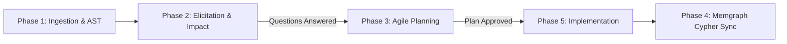

# Repository-Aware Developer & Memgraph Agent

An autonomous, repository-aware Senior Software Architect and Developer Agent system. Ingests codebases, maintains a live structural knowledge graph in **Memgraph** (Cypher), analyzes brief user feature requests, elicits missing requirements, produces production-grade Agile planning deliverables, writes implementation code, and keeps the graph state synchronized.

---

## 🌟 Architecture & Key Features

* **Python Backend & Agent Framework:** Powered by **LangGraph**, **LangChain**, and **FastAPI** to manage the multi-step stateful workflow, human-in-the-loop elicitation, memory persistence, and tool execution.
* **Memgraph Knowledge Graph (Cypher):** Live architectural mapping of the codebase (`:Repository`, `:Component`, `:File`, `:Service`, `:DatabaseTable`, linked via `[:CONTAINS]`, `[:DEPENDS_ON]`, `[:CALLS]`, `[:IMPORTS]`). Eliminates full codebase re-scanning for future queries.
* **Streamlit Frontend with Interactive Graph:** Interactive node-link network visualization (`vis-network`), feature elicitation chat, Agile deliverables inspector, and live code diff review.
* **Dynamic Model Selection & Resilience:**
  - **Task-Based Routing:** Autonomous model routing based on task complexity (lightweight models for scanning; reasoning models for planning/Cypher; coding models for implementation).
  - **Fallback Hierarchy:** Automatic fallback across configured model tiers if the primary endpoint times out or fails.
  - **Exponential Backoff:** Tenacity-backed retry logic with exponential backoff on transient errors and rate limits.
* **One-Click Containerization:** Complete `docker-compose.yml` for unified initialization of Memgraph, Memgraph Lab, FastAPI Backend, and Streamlit Frontend.

---

## 🚀 One-Click Spin-Up (Docker)

Ensure Docker Desktop is running, then run:

```bash
docker-compose up --build
```

### Active Service Endpoints:
* **Streamlit Agent UI:** [http://localhost:8501](http://localhost:8501)
* **FastAPI Backend & Swagger Docs:** [http://localhost:8000/docs](http://localhost:8000/docs)
* **Memgraph Lab (Visual Cypher Explorer):** [http://localhost:3000](http://localhost:3000)
* **Memgraph Bolt Port:** `localhost:7687`

---

## ⚙️ Environment Configuration

Copy `.env.example` to `.env` and configure your settings:

```ini
# Memgraph Database
MEMGRAPH_HOST=memgraph
MEMGRAPH_PORT=7687

# Dynamic Model Selection
PRIMARY_LLM_PROVIDER=ollama
OPENAI_BASE_URL=http://host.docker.internal:11434/v1
PRIMARY_API_KEY=ollama

# Task-Based Model Routing Tiers
MODEL_SCANNING=llama3.2:3b
MODEL_ELICITATION=llama3.1:8b
MODEL_PLANNING=llama3.1:8b
MODEL_CYPHER=qwen2.5-coder:7b
MODEL_CODING=qwen2.5-coder:7b

# Fallback Hierarchy
MODEL_FALLBACK_LIST=llama3.1:8b,qwen2.5-coder:7b,llama3.2:3b

# Exponential Backoff and Retry
LLM_MAX_RETRIES=4
LLM_BACKOFF_FACTOR=2.0
LLM_TIMEOUT_SECONDS=60.0
```

*Compatible with Ollama, Groq, OpenRouter, Together AI, or any OpenAI-compatible API endpoint.*

---

## 🔄 Phased Agent Workflow



1. **Phase 1: Initialization & Repository Ingestion**
   - Ingests Git remote URL or local path.
   - Parses AST (modules, classes, functions, tables, services).
   - Generates initial Cypher batch into Memgraph.
   - Outputs a concise 3-sentence high-level summary.
2. **Phase 2: Feature Analysis & Elicitation**
   - Ingests 1-2 line user feature request.
   - Cross-references Memgraph context to assess impact on modified modules and breaking changes.
   - Asks targeted clarification questions if requirements are ambiguous.
   - Explicitly identifies technical debt and security risks.
3. **Phase 3: Comprehensive Planning & Documentation**
   - Once user confirms requirements, produces:
     1. **Agile User Story** with Acceptance Criteria checkboxes.
     2. **Technical Design Document** (data models, API changes, component spec).
     3. **Systematic Work Plan** step-by-step checklist.
     4. **Risk Mitigation Plan**.
4. **Phase 4: Knowledge Graph Management (Memgraph)**
   - Generates valid Cypher statements reflecting new entities.
   - Renders live interactive network graph in Streamlit UI.
   - Produces a 1-paragraph live Context Summary.
5. **Phase 5: Implementation & State Update**
   - Generates production-ready, type-safe Python code fulfilling the work plan.
   - Executes Cypher `MERGE`/`MATCH` statements to update Memgraph.

---

## 🧪 Running Automated Tests

To run the test suite locally:

```bash
# 1. Create and activate virtual environment
python -m venv venv
.\venv\Scripts\Activate.ps1    # On Windows
# source venv/bin/activate     # On Linux/macOS

# 2. Install dependencies
pip install -r backend/requirements.txt

# 3. Execute pytest
$env:PYTHONPATH="D:\UserStory_Agent\backend"
pytest tests/ -v
```
